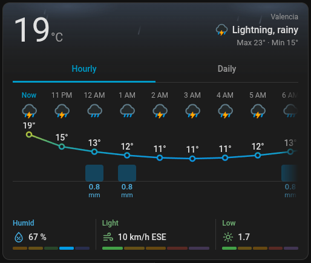
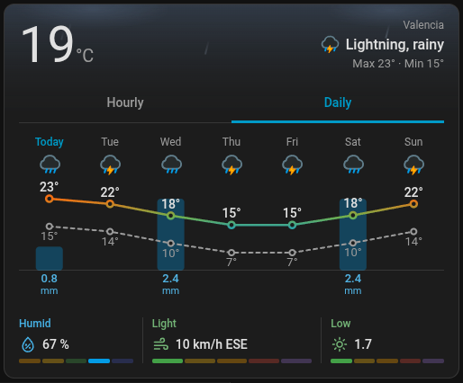
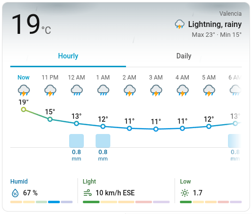
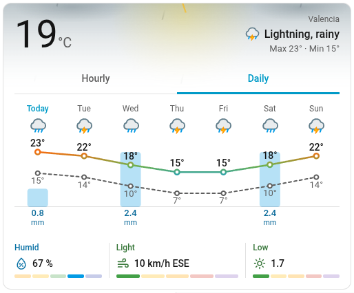
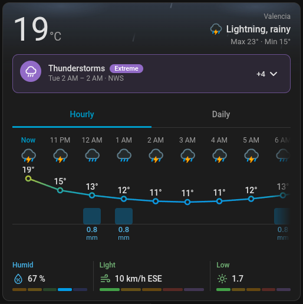
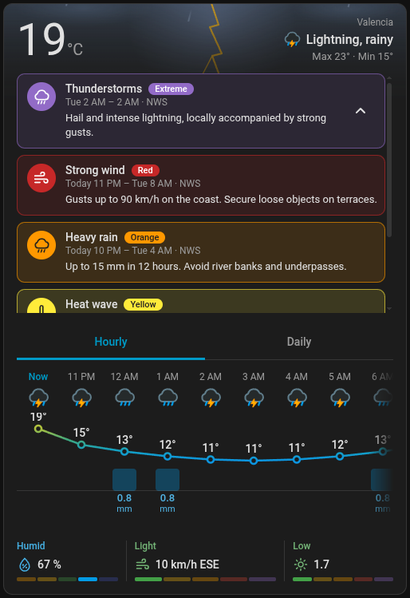
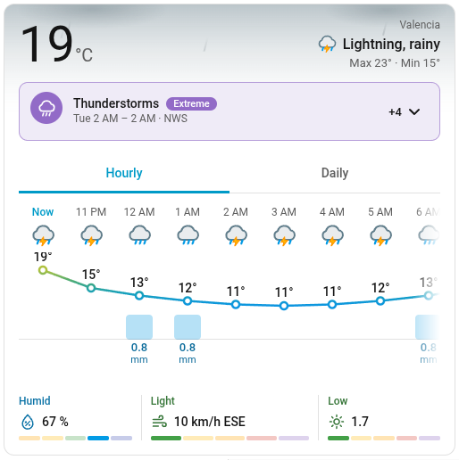
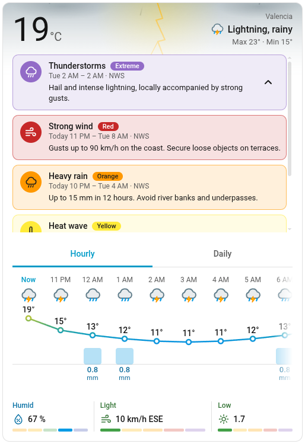
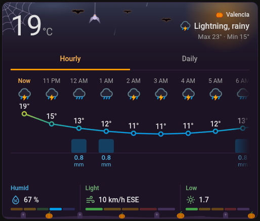
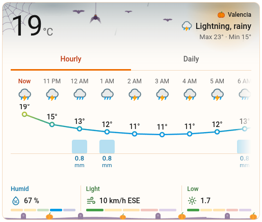

# Forecast at glance

A Home Assistant Lovelace card that shows the weather forecast at a glance: a temperature line over rain bars, hourly or daily, plus humidity, wind and UV with a 5-level scale each.

<p align="center">
  
  
</p>

<p align="center">
  
  
</p>

> **AI-assisted project.** This card is designed and written with the help of an AI assistant. It has automated tests and runs against a real Home Assistant during development.

## Features

- **Hourly and daily forecasts** with a temperature line, rain bars and weather icons. The hourly chart scrolls horizontally (drag with the mouse, swipe on touch).
- **Realtime**: forecasts arrive by subscription (`weather/subscribe_forecast`), so there is no polling, and the card only re-renders when its entities change.
- **Humidity, wind and UV** with a level label and a 5-segment scale.
- **Temperature colours** for the header icon and the chart line, with configurable cold and hot thresholds.
- **Per-value sensor overrides**: use your own sensors for temperature, humidity, wind speed or UV and get their updates in realtime.
- **Weather alerts** from Meteoalarm, NWS, Environment Canada or any sensor, shown as a banner that expands into a scrollable list.
- **Weather effects**: a light animated layer behind the header for each condition (sun glow, clouds, rain, snow, hail, fog, wind, lightning…), light and dark. It uses only compositor animations, pauses when the card is offscreen and stops with *reduced motion*.
- **Festivities**: decoration for Halloween, Christmas, New Year's Eve, Epiphany, Valentine's Day, Carnival, Fallas and Easter, switched on by date, see [Festivities](#festivities).
- **Tap actions** on the card and on the temperature (by default, the temperature opens the sensor history).
- **Visual editor** for every option, and everything is also available in YAML.
- **Themes**: only Home Assistant theme variables are used, so light, dark and custom themes apply automatically.
- **Languages**: English, Spanish, Dutch, German, French, Italian, Polish, Swedish, Danish, Norwegian and Portuguese. Dates, times and numbers follow your Home Assistant locale and units.

## Requirements

- Home Assistant **2023.9** or newer.
- A `weather.*` entity that provides hourly and/or daily forecasts. The tabs shown depend on what the integration supports: with only one of them, the card shows that view without tabs.

## Installation

### HACS

[](https://my.home-assistant.io/redirect/hacs_repository/?owner=Hydradox&repository=ha-forecast-card&category=plugin)

HACS adds the dashboard resource for you.

### Manual

1. Download `ha-forecast-card.js` from the [latest release](https://github.com/Hydradox/ha-forecast-card/releases/latest) into `config/www/`.
2. Go to **Settings → Dashboards → ⋮ → Resources** and add `/local/ha-forecast-card.js` as a **JavaScript module**.
3. Reload your browser.

## Usage

Add the card from the card picker (search for "Forecast at glance") and use the visual editor, or use YAML:

```yaml
type: custom:ha-forecast-card
entity: weather.home
```

Full example:

```yaml
type: custom:ha-forecast-card
entity: weather.home
name: Home
default_view: daily
hours_to_show: 12
temperature_entity: sensor.outdoor_temperature
humidity_entity: sensor.outdoor_humidity
cold_threshold: 5
hot_threshold: 30
tap_action:
  action: navigate
  navigation_path: /lovelace/weather
```

## Options

| Option | Type | Default | Description |
| --- | --- | --- | --- |
| `entity` | string | **required** | The `weather.*` entity providing conditions and forecasts. |
| `name` | string | entity name | Name shown above the condition. |
| `show_name` | boolean | `true` | Show or hide the name line. |
| `default_view` | `hourly` \| `daily` | `hourly` | Tab shown first. Falls back to the other one if the integration lacks it. |
| `hours_to_show` | integer ≥ 1 | `10` | Hourly columns, counting the "Now" column. |
| `days_to_show` | integer ≥ 1 | `7` | Daily columns. |
| `temperature_entity` | entity id | | Sensor used for the current temperature instead of the weather entity. |
| `humidity_entity` | entity id | | Sensor used for humidity. |
| `wind_speed_entity` | entity id | | Sensor used for wind speed (its unit is respected). |
| `uv_index_entity` | entity id | | Sensor used for the UV index. |
| `cold_threshold` | number | `0` °C / `32` °F | At or below this temperature the colour is fully cold (blue). |
| `hot_threshold` | number | `35` °C / `95` °F | At or above this temperature the colour is fully hot (red). Must be greater than `cold_threshold`. |
| `tap_action` | action | `more-info` | What tapping the card does. Opens the weather entity by default. |
| `temperature_tap_action` | action | `more-info` | What tapping the temperature does. Opens the history of `temperature_entity`, or the weather entity if none is set. |
| `alerts` | object | | Weather alerts, see [Alerts](#alerts). |
| `language` | string | Home Assistant language | Force a language (`en`, `es`). Also used for the condition names. |
| `weather_effects` | boolean | `true` | Animated weather effect behind the header (rain, snow, sun glow…). Set `false` to turn it off. |
| `festivity` | string | `auto` | Seasonal decoration, see [Festivities](#festivities). |
| `festivities` | object | | Turn individual festivities off or correct their dates, see [Festivities](#festivities). |

**Thresholds** are in your Home Assistant temperature unit. Leave them out to use the defaults, which follow the unit system.

**Actions** support `more-info`, `navigate`, `url`, `toggle`, `perform-action` and `none`. Only tap is supported (no hold or double tap yet).

**Missing data** is handled gracefully: humidity, wind and UV only appear when a value exists, and rain falls back to precipitation probability if the integration provides no amounts.

### Alerts

Home Assistant has no standard weather-alert API, so the card reads alerts from the entities your provider integration creates. An adapter per provider converts them to one level scale: 1 yellow, 2 orange, 3 red, 4 extreme.

<p align="center">
  
  
</p>

<p align="center">
  
  
</p>

```yaml
type: custom:ha-forecast-card
entity: weather.home
alerts:
  entities:
    - binary_sensor.meteoalarm_madrid
    - entity: sensor.mi_proveedor
      adapter: custom
      level_attr: nivel
      event_attr: titulo
      expires_attr: fin
      levels:
        leve: 1
        fuerte: 3
  min_level: 1
  max_visible: 1
```

| Option | Type | Default | Description |
| --- | --- | --- | --- |
| `alerts.entities` | list | **required** | Entity ids, or objects with the options below. |
| `alerts.min_level` | 1–4 | `1` | Hide alerts below this level. |
| `alerts.max_visible` | integer ≥ 1 | `1` | Alerts shown while collapsed. The rest, and the descriptions, appear when expanded. |

Options of an entity object:

| Option | Description |
| --- | --- |
| `entity` | **Required.** The alert entity. |
| `adapter` | `auto` (default, detected from the entity), `meteoalarm`, `nws`, `environment_canada` or `custom`. |
| `level_attr` | Attribute holding the level. With `custom` it is required. |
| `event_attr`, `headline_attr`, `description_attr`, `starts_attr`, `expires_attr` | Attribute names, to override what the adapter looks for. |
| `levels` | Maps the raw value of `level_attr` to a level (0 hides it). Numbers 1–4 need no map. |

How each provider is mapped:

| Provider | Reads | Level |
| --- | --- | --- |
| Meteoalarm | `awareness_level` colour, else `severity` | yellow / Moderate = 1, orange / Severe = 2, red / Extreme = 3. Green and Minor are hidden. |
| NWS | `severity` of each item in the `alerts` attribute | Minor = 1, Moderate = 2, Severe = 3, Extreme = 4 |
| Environment Canada | The sensor type (`*_warnings`, `*_watches`, `*_statements`, `*_advisories`) | warning = 3, watch = 2, statement and advisory = 1. Endings are hidden. |
| Anything else | `custom` adapter | From `level_attr` and `levels`. |

An entity can carry one alert in its attributes, or a list in an `alerts` attribute. Inactive entities (`off`, `0`, `unavailable`) and alerts whose end time has passed are ignored. With no alerts the banner takes no space. When the expanded list is taller than 300 px it scrolls vertically; change that with the `--hfc-alerts-max-height` CSS variable. Alert colours are `--hfc-alert-1` to `--hfc-alert-4`.

The visual editor lists entity ids. Entries that use an adapter object are YAML-only and are kept when you edit in the UI.

> The attribute names above come from the integrations' documented behaviour and have not been checked against live data yet. If an alert does not show, check the entity attributes in Developer Tools and use `custom` with the matching attribute names.

### Scales

The level shown for each metric uses fixed ranges:

| Level | 1 | 2 | 3 | 4 | 5 |
| --- | --- | --- | --- | --- | --- |
| Humidity (%) | < 30 | < 40 | < 60 | < 80 | ≥ 80 |
| Wind (km/h) | < 20 | < 40 | < 60 | < 90 | ≥ 90 |
| UV index | < 3 | < 6 | < 8 | < 11 | ≥ 11 |

Wind in other units is converted before choosing the level.

### Festivities

<p align="center">
  
  
</p>

Halloween is shown above. Epiphany, Valentine's Day, Carnival, Fallas, Easter, Christmas and New Year's Eve also exist, each with its own palette, ornaments and animation, and you will see them on their dates (or by forcing one with `festivity`).

`festivity` controls the seasonal decoration (palette, ambient animation, corner and bottom ornaments and a small icon before the name). It sits on top of the weather effect and replaces the theme's card colours while active.

| Value | Result |
| --- | --- |
| `auto` (default) | Follows the calendar (below). Nothing outside those dates. |
| `none` | Never decorate. |
| `epiphany`, `valentine`, `carnival`, `fallas`, `easter`, `halloween`, `christmas`, `new_year` | Always use that one. |
| an entity id | Reads the state of an entity (for instance an `input_select`) holding any of the values above. |

| Festivity | Automatic dates |
| --- | --- |
| `epiphany` | Jan 2–6 |
| `valentine` | Feb 10–14 |
| `carnival` | Thursday before Shrove Tuesday to Shrove Tuesday |
| `fallas` | Mar 15–19 (off by default, turn it on with `enabled: true`) |
| `easter` | Palm Sunday to Easter Monday |
| `halloween` | Oct 24 – Nov 1 |
| `christmas` | Dec 1–26 |
| `new_year` | Dec 27 – Jan 1 |

When windows overlap, the fixed date wins (Valentine's Day and Fallas over Carnival and Easter). Dates use the date of the device showing the card.

#### Turning one off or correcting its dates

With `festivity: auto`, the `festivities` option adjusts each festivity on its own. Everything is optional; leave a festivity out to keep its defaults. The visual editor lists every festivity with its default dates.

```yaml
type: custom:ha-forecast-card
entity: weather.home
festivities:
  halloween:
    enabled: false # never decorate for Halloween
  fallas:
    enabled: true # Fallas is off unless you turn it on
    start: "03-10" # MM-DD, inclusive
    end: "03-19"
  easter:
    start_offset: -3 # days from Easter Sunday (negative = before)
    end_offset: 1
```

- `enabled` (default `true`, except `fallas`, which is `false`): when off it is skipped, and the next festivity that matches the date (if any) applies.
- `start` / `end` (`MM-DD`): for the fixed festivities. A window may wrap over the new year (`new_year`: `12-27` to `01-01`).
- `start_offset` / `end_offset` (whole days from Easter Sunday): for `easter` (default `-7` to `1`) and `carnival` (default `-52` to `-47`).

These rules only affect `auto`. Setting `festivity` to a name (or an entity that returns one) always shows that festivity.

## Theming

The card uses only Home Assistant theme variables (`--primary-text-color`, `--ha-card-background`, `--divider-color`, …), so it follows your theme with no extra setup. Colours are exposed as `--hfc-*` variables if you want to adjust them, for example with [card-mod](https://github.com/thomasloven/lovelace-card-mod):

```yaml
type: custom:ha-forecast-card
entity: weather.home
card_mod:
  style: |
    :host {
      --hfc-rain: var(--teal-color);
      --hfc-sun-fill: orange;
    }
```

The full list of variables is in [`src/styles/tokens.ts`](src/styles/tokens.ts).

## Development

```bash
npm install
npm run watch      # rebuild dist/ha-forecast-card.js on change
npm run build      # production bundle
npm run typecheck && npm run lint && npm test
```

### Try it in a real Home Assistant (Podman)

```bash
npm run build         # or keep `npm run watch` running
npm run dev:ha        # starts Home Assistant on http://localhost:8123 and sets everything up
```

Log in with `dev` / `dev`. The script registers the card as a dashboard resource, creates a "Forecast dev" dashboard with several card variants, and adds template weather entities (`weather.dev_weather`, `weather.dev_weather_daily_only`) plus sensors, driven by input helpers (condition, temperature, humidity, wind, UV, rain) so you can change the fake weather live. A **Festivities** view shows every festivity at once, and the other views follow the *Festivity* control (`input_select.dev_festivity`, set to `auto` by default). A **Gallery** view shows one card per weather condition. Switch light/dark in your browser profile to check both palettes. Two custom themes (`Dev Warm`, `Dev Mono`) are available in your profile. To test °F, set the unit system to US customary in Settings → General.

After rebuilding, run `npm run dev:ha` again (it is safe to repeat and busts the cache) or hard-reload the browser. Other commands: `npm run dev:ha:logs`, `npm run dev:ha:down` and `npm run dev:ha:reset` (wipes the dev Home Assistant state). Set `HA_PORT` or `HA_IMAGE` to change the port or image. The state lives in `dev/config` and is git-ignored.

### Contributing

Use [Conventional Commits](https://www.conventionalcommits.org) for commit messages and PR titles (`feat:`, `fix:`, …). Releases, versions and the changelog are generated automatically from them. To add a language, add `src/localize/translations/<lang>.json` and register it in `src/localize/index.ts`.

## License

[GPL-3.0-or-later](LICENSE)
