# Forecast at glance

A Home Assistant Lovelace card that shows the weather forecast at a glance: a temperature line over rain bars (hourly or daily), humidity, wind and UV with a 5-level scale each, weather alerts, an optional camera and seasonal decoration.

<p align="center">
  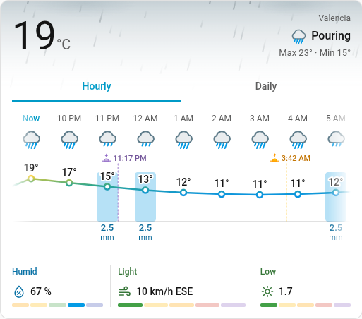
  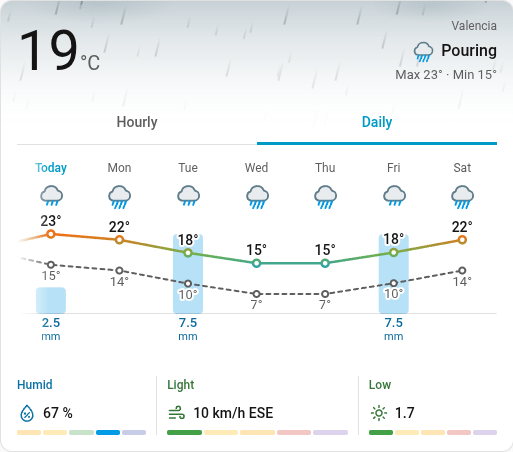
</p>

<p align="center">
  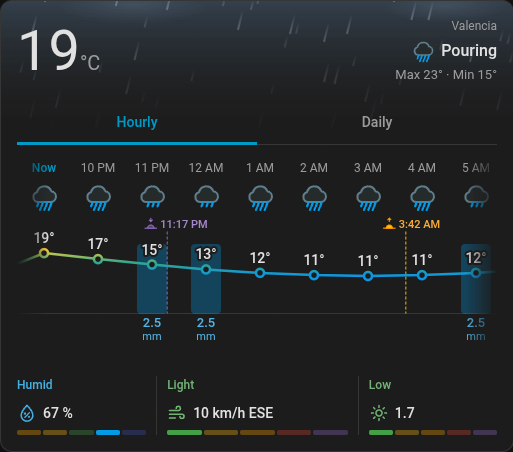
  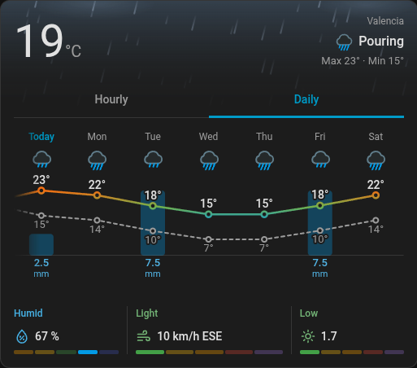
</p>

> **AI-assisted project.** This card is designed and written with the help of an AI assistant. It has automated tests and runs against a real Home Assistant during development.

## Contents

- [Installation](#installation)
- [Usage](#usage)
- [Options](#options)
- [Features](#features)
  - [Camera](#camera)
  - [Alerts](#alerts)
  - [Festivities](#festivities)
  - [Theming](#theming)
- [Development](#development)
- [License](#license)

## Installation

Requires Home Assistant **2023.9** or newer and a `weather.*` entity with hourly and/or daily forecasts. With only one of them, the card shows that view without tabs.

### HACS

[](https://my.home-assistant.io/redirect/hacs_repository/?owner=Hydradox&repository=ha-forecast-card&category=plugin)

HACS adds the dashboard resource for you.

### Manual

1. Download `ha-forecast-card.js` from the [latest release](https://github.com/Hydradox/ha-forecast-card/releases/latest) into `config/www/`.
2. Go to **Settings → Dashboards → ⋮ → Resources** and add `/local/ha-forecast-card.js` as a **JavaScript module**.
3. Reload your browser.

## Usage

Add the card from the card picker ("Forecast at glance") and use the visual editor, or use YAML:

```yaml
type: custom:ha-forecast-card
entity: weather.home
```

A fuller example:

```yaml
type: custom:ha-forecast-card
entity: weather.home
name: Home
default_view: daily
temperature_entity: sensor.outdoor_temperature
camera_entity: camera.garden
tap_action:
  action: navigate
  navigation_path: /lovelace/weather
```

### Several locations

Show more than one place in the same card with `locations`. Each entry takes the same options as a single card (everything in the table below except `type` and `language`, which stay at the top level). With two or more, the name line becomes a selector (pin, name and chevron) that lists each place with its condition and temperature; `show_name` is then always on, and `name` defaults to the entity name.

```yaml
type: custom:ha-forecast-card
locations:
  - entity: weather.home
    name: Home
    camera_entity: camera.garden
  - entity: weather.beach
    name: Beach
    default_view: daily
    temperature_entity: sensor.beach_temperature
```

Only the selected place subscribes to forecasts and history or loads its camera; the others are only read (condition and temperature) while the selector is open, so extra places cost nothing at rest. The visual editor shows one tab per place with add/remove buttons and you drag a tab (mouse or touch; arrow keys also work) to reorder them. A single entry in `locations` behaves like a plain card.

## Options

| Option | Type | Default | Description |
| --- | --- | --- | --- |
| `entity` | string | **required** (unless `locations`) | The `weather.*` entity. |
| `locations` | list | | Several places, see [Several locations](#several-locations). |
| `name` | string | entity name | Name shown above the condition. |
| `show_name` | boolean | `true` | Show the name line. |
| `default_view` | `hourly` \| `daily` \| `camera` | `hourly` | Tab shown first. Falls back to the first available tab (`camera` needs a [camera tab](#camera)). |
| `hours_to_show` | integer ≥ 1 | `10` | Hourly columns, counting "Now". |
| `days_to_show` | integer ≥ 1 | `7` | Daily columns. |
| `history_hours` | integer ≥ 0 | `12` | Past hours reachable by scrolling back (from the recorder history of `temperature_entity` or the weather entity). `0` disables it. |
| `history_days` | integer ≥ 0 | `3` | Same for the daily view, with each day's recorded high and low. |
| `temperature_entity` | entity id | | Sensor for the current temperature. Tapping it opens the sensor's history. |
| `humidity_entity` | entity id | | Sensor for humidity. Tapping the value opens the sensor's history. |
| `wind_speed_entity` | entity id | | Sensor for wind speed (its unit is respected). Tapping the value opens the sensor's history. |
| `uv_index_entity` | entity id | | Sensor for the UV index. Tapping the value opens the sensor's history. |
| `sun_entity` | `sun.*` | | Home Assistant's [Sun](https://www.home-assistant.io/integrations/sun/) entity (`sun.sun`). Marks the next sunrise or sunset on the hourly chart (dashed line with its time) and shows the moon instead of the sun on clear hours after dark. Set per place: the Sun integration follows the Home Assistant location, so leave it out for places elsewhere. |
| `sunrise_entity` / `sunset_entity` | entity | | Sunrise and sunset from any entity whose state is a timestamp, such as [Sun2](https://github.com/pnbruckner/ha-sun2)'s `sensor.*_next_rising` and `sensor.*_next_setting`, or a template sensor. They override the values of `sun_entity`, which is not needed then: Home Assistant allows only one Sun entity, so use these for other places. |
| `cold_threshold` | number | `0` °C / `32` °F | At or below this the colour is fully cold. |
| `hot_threshold` | number | `35` °C / `95` °F | At or above this the colour is fully hot. Must be greater than `cold_threshold`. |
| `tap_action` | action | `more-info` | Tap on the header text (condition and range; the weather entity by default). |
| `temperature_tap_action` | action | `more-info` | Tap on the temperature (the history of `temperature_entity`, or the weather entity). |
| `camera_*` | | | See [Camera](#camera). |
| `alerts` | object | | See [Alerts](#alerts). |
| `weather_effects` | boolean | `true` | Animated weather effect behind the header. |
| `festivity`, `festivities` | | `auto` | See [Festivities](#festivities). |
| `language` | string | HA language | Force a language (`en`, `es`…). |

Thresholds are in your Home Assistant temperature unit. Actions support `more-info`, `navigate`, `url`, `toggle`, `perform-action` and `none` (tap only). Missing data is handled gracefully: humidity, wind and UV only appear when a value exists.

## Features

- Hourly and daily forecasts, updated by subscription (no polling). Scroll back to see recorded past hours and days.
- Humidity, wind and UV with a level label and a 5-segment scale.
- Temperature colours with configurable cold and hot thresholds.
- Your own sensors for temperature, humidity, wind or UV.
- [Camera](#camera): a tab or an expandable strip, with live stream when the camera supports it.
- [Weather alerts](#alerts) from Meteoalarm, NWS, Environment Canada or any sensor.
- Animated weather effects and [seasonal decoration](#festivities).
- Visual editor for every option (YAML works too). Follows your theme, locale and units.
- Languages: English, Spanish, Dutch, German, French, Italian, Polish, Swedish, Danish, Norwegian and Portuguese.

### Camera

Set `camera_entity` and the card shows the camera. Without it, nothing camera-related appears.

<p align="center">
  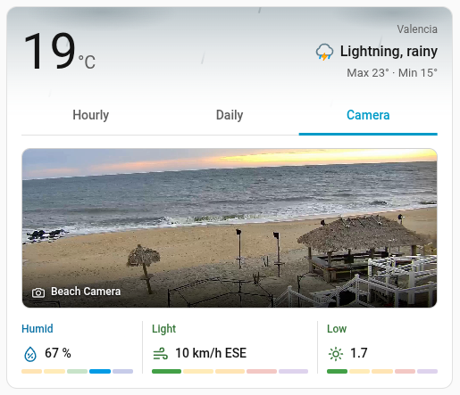
  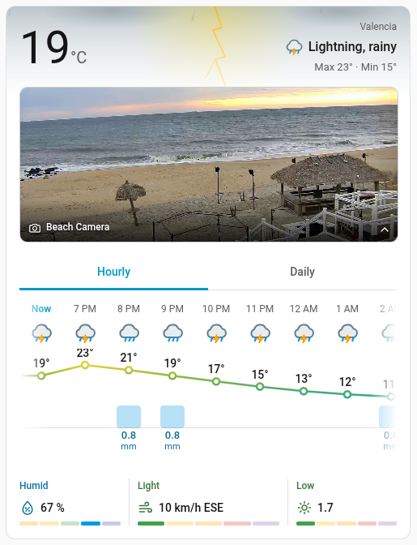
</p>

<p align="center">
  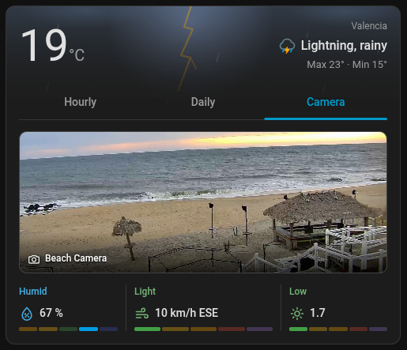
  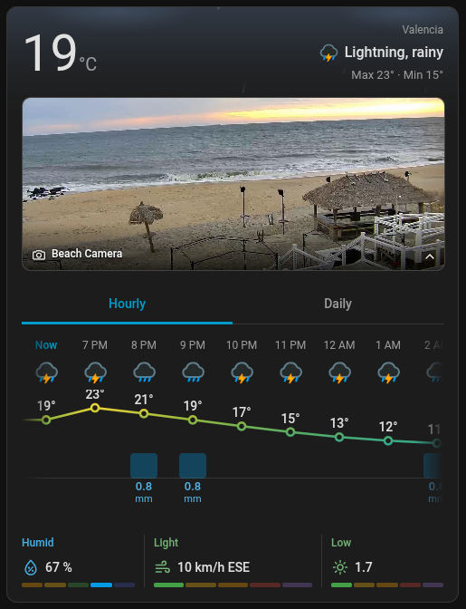
</p>

```yaml
type: custom:ha-forecast-card
entity: weather.home
camera_entity: camera.garden
camera_layout: strip
```

| Option | Type | Default | Description |
| --- | --- | --- | --- |
| `camera_entity` | `camera.*` | | The camera to show. |
| `camera_layout` | `tab` \| `strip` | `tab` | `tab` adds a third tab next to Hourly and Daily. `strip` shows a band under the header that expands when tapped. |
| `camera_name` | string | entity name | Label over the image. |
| `camera_refresh` | seconds ≥ 1 | `300` | Seconds between reloads of the still image. |
| `camera_tap_action` | action | `more-info` | Tap on the image. Opens the camera's live view by default. |

- **Live or still.** If the camera supports streaming, the card plays the live stream with Home Assistant's own player. Otherwise it shows a still image reloaded every `camera_refresh` seconds.
- **Only while visible.** A tab plays while selected; the strip plays only when expanded (collapsed, it shows a still).
- **Strip.** Collapsed, tapping it expands it. Expanded, tapping the image runs `camera_tap_action` and the arrow collapses it.
- **Webcam from a URL.** Add it with the [Generic Camera](https://www.home-assistant.io/integrations/generic/) integration and use the entity it creates.
- With `default_view: camera` the card opens on the camera tab.

### Alerts

Home Assistant has no standard alert API, so the card reads the entities your provider integration creates and converts them to one scale: 1 yellow, 2 orange, 3 red, 4 extreme. With no alerts the banner takes no space.

<p align="center">
  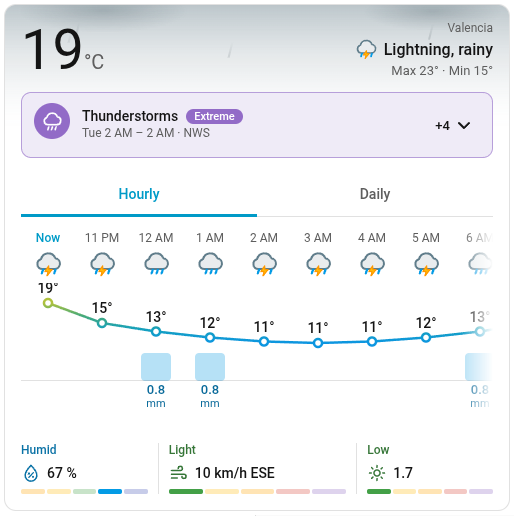
  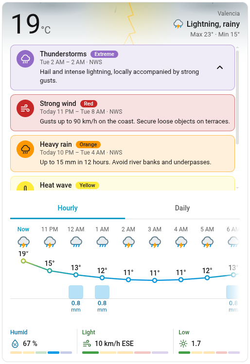
</p>

<p align="center">
  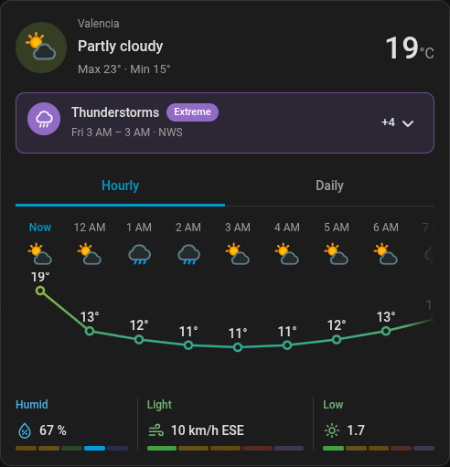
  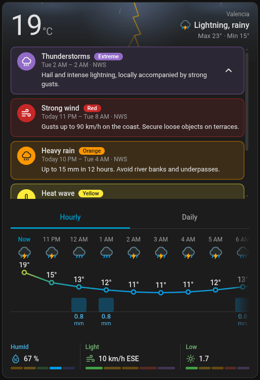
</p>

```yaml
alerts:
  entities:
    - binary_sensor.meteoalarm_madrid
    - entity: sensor.my_provider # any other sensor
      adapter: custom
      level_attr: level
      levels: { low: 1, high: 3 }
  min_level: 1
  max_visible: 1
```

| Option | Default | Description |
| --- | --- | --- |
| `alerts.entities` | **required** | Entity ids, or objects (below). |
| `alerts.min_level` | `1` | Hide alerts below this level (1–4). |
| `alerts.max_visible` | `1` | Alerts shown while collapsed; the rest and the descriptions appear when expanded. |

An entity object takes `entity` (required), `adapter` (`auto` by default, `meteoalarm`, `nws`, `environment_canada` or `custom`), `level_attr`, `levels` (maps raw values to a level, `0` hides it) and the attribute names `event_attr`, `headline_attr`, `description_attr`, `starts_attr`, `expires_attr`. Objects are YAML-only; the visual editor keeps them.

| Provider | Level |
| --- | --- |
| Meteoalarm | `awareness_level` colour, else `severity`: yellow/Moderate 1, orange/Severe 2, red/Extreme 3 |
| NWS | `severity` of each item in `alerts`: Minor 1 to Extreme 4 |
| Environment Canada | Sensor type: warning 3, watch 2, statement/advisory 1 |
| Other | `custom` adapter, from `level_attr` and `levels` |

Inactive entities and expired alerts are ignored. The expanded list scrolls past 300 px (`--hfc-alerts-max-height`).

> The attribute names come from the integrations' documented behaviour and have not been checked against live data. If an alert does not show, check the entity attributes in Developer Tools and use `custom`.

### Festivities

<p align="center">
  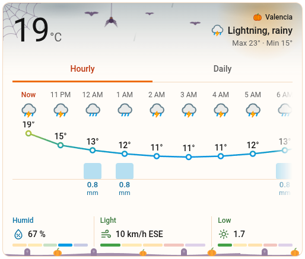
  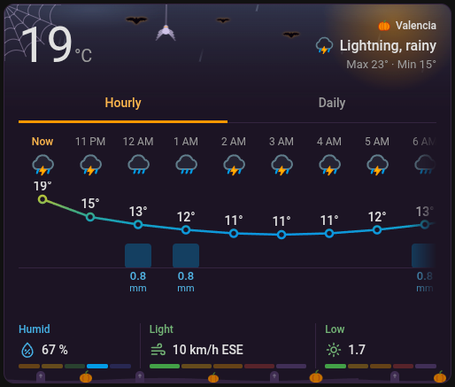
</p>

`festivity` adds seasonal decoration (palette, animation and ornaments).

| Value | Result |
| --- | --- |
| `auto` (default) | Follows the calendar below. |
| `none` | Never decorate. |
| a name | Always that festivity: `epiphany`, `valentine`, `carnival`, `fallas`, `easter`, `halloween`, `christmas`, `new_year`. |
| an entity id | The state of an entity (such as an `input_select`) holding one of the values above. |

| Festivity | Automatic dates |
| --- | --- |
| `epiphany` | Jan 2–6 |
| `valentine` | Feb 10–14 |
| `carnival` | Thursday before Shrove Tuesday to Shrove Tuesday |
| `fallas` | Mar 15–19 (off by default) |
| `easter` | Palm Sunday to Easter Monday |
| `halloween` | Oct 24 – Nov 1 |
| `christmas` | Dec 1–26 |
| `new_year` | Dec 27 – Jan 1 |

With `auto`, `festivities` turns one off or corrects its dates:

```yaml
festivities:
  halloween:
    enabled: false
  fallas:
    enabled: true
    start: "03-10" # MM-DD
    end: "03-19"
  easter:
    start_offset: -3 # days from Easter Sunday
    end_offset: 1
```

`start` / `end` apply to fixed festivities (a window may wrap over the new year); `start_offset` / `end_offset` to `easter` and `carnival`. When windows overlap, the fixed date wins.

### Theming

Only Home Assistant theme variables are used, so any theme applies. Colours are exposed as `--hfc-*` variables (full list in [`src/styles/tokens.ts`](src/styles/tokens.ts)), for example with [card-mod](https://github.com/thomasloven/lovelace-card-mod):

```yaml
card_mod:
  style: |
    :host {
      --hfc-rain: var(--teal-color);
    }
```

## Development

```bash
npm install
npm run watch      # rebuild on change
npm run build      # production bundle
npm run typecheck && npm run lint && npm test
```

`npm run dev:ha` starts a throwaway Home Assistant in Podman on http://localhost:8123 (login `dev` / `dev`) with the card, test weather entities and a dashboard with many variants. Other commands: `dev:ha:logs`, `dev:ha:down`, `dev:ha:reset`. The state lives in `dev/config` (git-ignored). The **Camera** view expects a Generic Camera entity called `camera.garcimolina_net`.

Use [Conventional Commits](https://www.conventionalcommits.org) for commits and PR titles: releases and the changelog are generated from them. To add a language, add `src/localize/translations/<lang>.json` and register it in `src/localize/index.ts`.

## License

[GPL-3.0-or-later](LICENSE)
